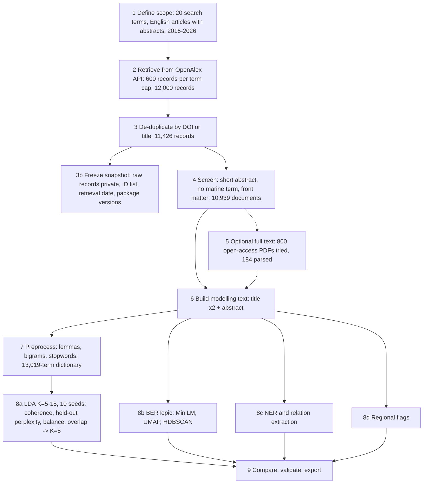

# Marine-science literature: topic modelling workflow

A reproducible, notebook-based workflow for exploring marine-science literature indexed by [OpenAlex](https://openalex.org/). It retrieves records, screens them, builds topic models (LDA and BERTopic), extracts entities and candidate relations, and exports review tables and figures.

Companion code for the paper *Exploratory Topic Modelling of Marine Science Literature: A Computational Literature Review* (Govender, 2026). Repository: https://github.com/sterlingconsultants/Marine-Science

This is an **exploratory** tool. Topic labels, extracted relations and regional flags are candidates for human review, not findings.

## Workflow

## Results of the primary run (1 November 2026)

| Item | Result |
|---|---|
| Records retrieved / unique / analysed | 12,000 / 11,426 / 10,939 |
| Open-access full texts parsed | 184 (1.7% of the corpus) |
| LDA topics selected | 5 (10 seeds; every K from 5 to 15 was within 0.02 of the best mean Cv, so the rule chose the smallest; held-out perplexity is also lowest at K = 5) |
| LDA vs BERTopic agreement | ARI 0.146, NMI 0.256 (excluding 3,060 outliers) |
| Candidate relations | 8,162 (not validated) |

### The number of topics is not stable

The same pipeline was run six times. Small differences in the data or preprocessing changed the K chosen by the coherence-based rule:

| | Run 1 | Run 2 | Run 3 | Run 4 | Run 5 (primary) | Run 6 |
|---|---|---|---|---|---|---|
| Retrieval | earlier (Oct 2026) | earlier (Oct 2026) | 28 Oct 2026 | 29 Oct 2026 | 1 Nov 2026 | not recorded** |
| Seeds per K | 3 | 3 | 3 | 3 | 10 | 10 |
| Documents analysed | 10,902 | 10,902 | 10,885 | 10,907 | 10,939 | 10,939 |
| Generic-term list | 4 words not removed* | complete | complete | complete | complete | complete |
| **Selected K** | **5** | **8** | **5** | **10** | **5** | **7** |
| Mean Cv at K = 5 / 8 / 10 | 0.512 / 0.491 / 0.498 | 0.452 / 0.537 / 0.529 | 0.528 / 0.498 / 0.516 | 0.526 / 0.527 / 0.559 | 0.515 / 0.519 / 0.523 | 0.509 / 0.525 / 0.523 |
| Lowest held-out perplexity | K = 5 | K = 5 | K = 5 | K = 5 | K = 5 | K = 5 |
| ARI / NMI (LDA vs BERTopic) | 0.088 / 0.193 | 0.281 / 0.392 | 0.095 / 0.192 | 0.141 / 0.330 | 0.146 / 0.256 | 0.119 / 0.278 |

*produce, require, regional, give. **Run 6 has the same record counts as Run 5; its retrieval date and package versions were not recorded.

Held-out perplexity was lowest at K = 5 in all six runs, but coherence differences between values of K are smaller than the variation across seeds and corpora. Report K as a range, use more seeds and freeze the corpus (below).

## Run it

1. Open `Marine_Science_Topic_Modelling.ipynb` in Google Colab.
2. Get a free OpenAlex API key (required since February 2026) from your OpenAlex account settings.
3. In Colab, open **Secrets** (key icon) and add `OPENALEX_API_KEY` and `MAILTO` (your email address), with notebook access switched on.
4. Run all cells. The first run downloads the `all-MiniLM-L6-v2` model from Hugging Face; no Hugging Face token is needed.

Outputs are written to the notebook's output folder. No credentials are stored in the notebook. Never paste keys into code cells.

### Freeze the data and use more seeds

- **Freeze:** after a fresh retrieval the notebook saves `outputs/raw_records_frozen.parquet` (private, contains abstracts), `corpus_snapshot.csv` (IDs and screening decisions, safe to publish) and `run_metadata.json` (retrieval date, settings, package versions). Colab storage is temporary, so copy these to Google Drive. To repeat the analysis on the same records, set `USE_FROZEN = True` in the setup cell.
- **Seeds:** the default `N_SEEDS = 10` reproduces the paper (seeds 11, 42, 99 and 100-106) and took about 3.3 hours with two parallel workers in the author's run. Set `N_SEEDS = 3` for a quick run (about a third of the time). Model fitting runs in parallel and every fitted model is cached, so an interrupted run resumes. Held-out perplexity uses the first three seeds only; coherence uses all seeds.

## Data policy

- This repository contains **code and identifiers only**. It does not include retrieved records, abstracts, downloaded PDFs or extracted full text.
- OpenAlex metadata is published by OpenAlex under its own terms (check https://openalex.org for the current licence). Abstracts and PDFs belong to their publishers and authors, so do not redistribute them. Share DOI or OpenAlex ID lists (`corpus_snapshot.csv`) instead.
- Re-running a search later returns different records because OpenAlex is updated continuously.

## Reproducibility notes

- Fixed seeds: LDA seeds 11, 42, 99 and 100-106; held-out split seed 2026; UMAP seed 42.
- Package versions are not pinned in `requirements.txt`; `run_metadata.json` records the versions used in each run.
- Python 3.13 on Google Colab was used.

## AI assistance

Declaration of generative AI and AI-assisted technologies in the manuscript preparation process. During the preparation of this work, the author used ChatGPT (OpenAI, [GPT-6, October 2026]) to review the manuscript and Claude (Anthropic, [Sonnet 5.5, November 2026]) to help draft and revise the manuscript text, tables and appendices from the author’s analysis outputs, to help write and debug the analysis code, and to generate the data visualisations and workflow diagram through reproducible code. After using these tools, the author ran the code, checked the results against the outputs, reviewed and edited the content as needed and takes full responsibility for the content of the published article.

## Licence

Code is released under the MIT licence (see `LICENSE`). Figures and documentation may be reused with attribution.
